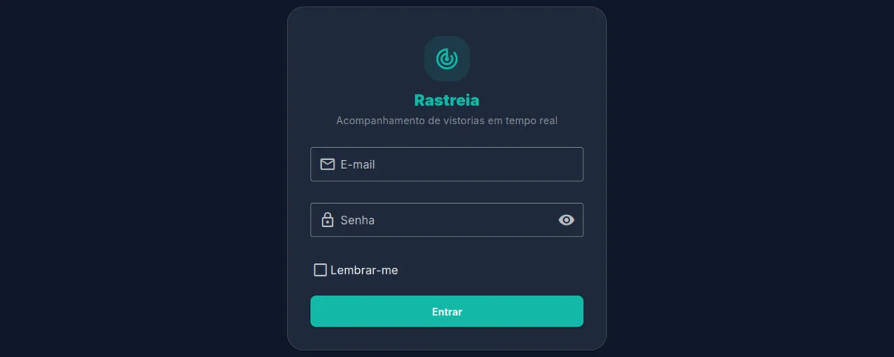
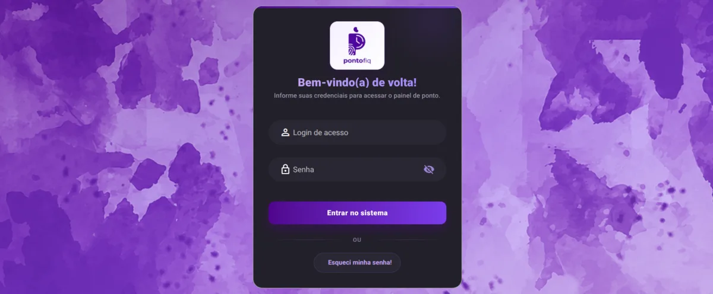
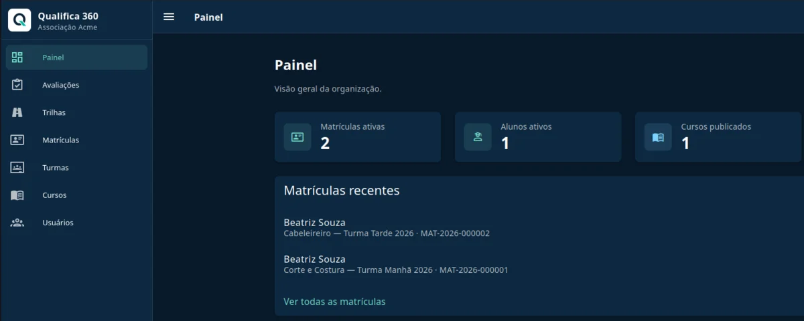
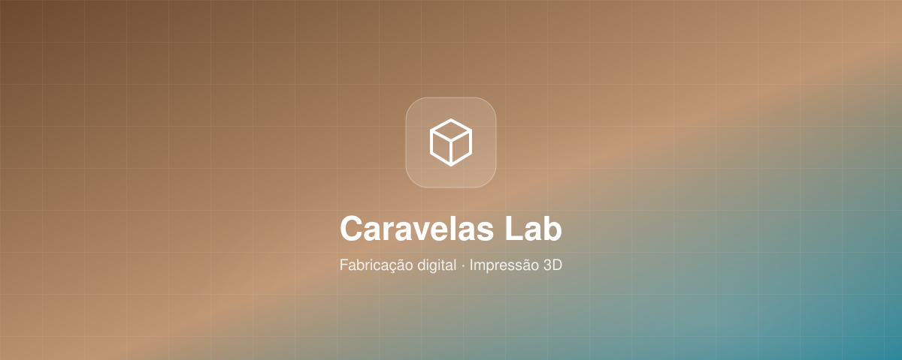
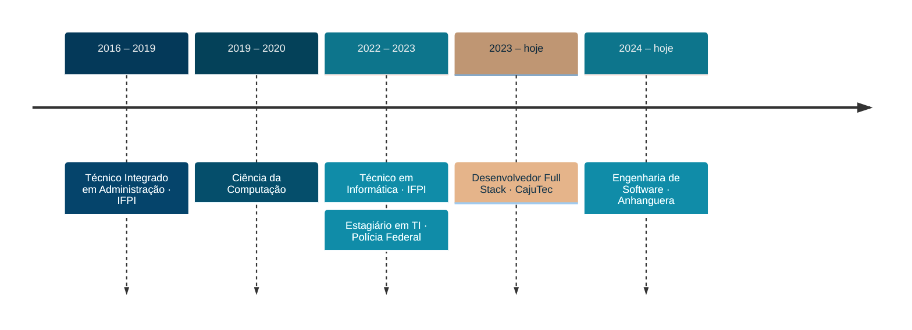

<!-- ════════════════════ CABEÇALHO ════════════════════ -->
<p align="center">
  
</p>

<p align="center">
  <picture>
    <source media="(prefers-color-scheme: dark)" srcset="https://readme-typing-svg.demolab.com?font=JetBrains+Mono&weight=500&size=20&duration=3200&pause=900&color=5BC0D4&center=true&vCenter=true&width=640&lines=Desenvolvedor+Full+Stack+na+CajuTec;Laravel+%2B+Vue.js+%2B+React+%2B+Next.js;Sistemas+SaaS+e+multi-tenant;Integra%C3%A7%C3%B5es+financeiras%3A+PIX%2C+boleto+e+carn%C3%AAs;C%C3%B3digo+limpo%2C+testado+com+Pest+e+Playwright" />
    
  </picture>
</p>

<p align="center">
  
  
  
  
</p>

<br />

## 👨🏻‍💻 Sobre mim

Sou **Desenvolvedor Full Stack na CajuTec**, onde desenvolvo e mantenho sistemas web com **Laravel (PHP), Vue.js e MySQL**. Tenho base sólida em Lógica de Programação, Estruturas de Dados e Programação Orientada a Objetos.

Gosto de resolver problemas técnicos complexos e de criar interfaces intuitivas. Trabalho com APIs RESTful, design responsivo e frameworks JavaScript, e tenho o hábito de escrever testes com **Pest PHP** para garantir a qualidade do código.

O que mais me motiva é encarar desafios que me tiram da zona de conforto e encontrar soluções criativas para problemas que, de início, parecem impossíveis.

- 🏢 Full Stack na **CajuTec** desde 2023
- 🎓 Bacharelado em **Engenharia de Software** (Anhanguera) em andamento
- 🧪 Qualidade com **Pest** e testes end-to-end com **Playwright**
- 💳 Experiência real com **integrações bancárias e meios de pagamento**

> [!NOTE]
> **Atualmente:** construindo plataformas SaaS multi-tenant, estudando Arquitetura de Software e evoluindo em Docker, CI/CD e AWS.

## 🛠️ Stack

<table>
  <tr>
    <td align="center" width="33%"><b>Linguagens &amp; Backend</b></td>
    <td align="center" width="33%"><b>Frontend</b></td>
    <td align="center" width="33%"><b>Infra &amp; Ferramentas</b></td>
  </tr>
  <tr>
    <td align="center"></td>
    <td align="center"></td>
    <td align="center"></td>
  </tr>
</table>

<p align="center">
  
  
  
  
  
</p>

## 🚀 Projetos em destaque

<table>
  <tr>
    <td width="50%" valign="top">
      
      <h3>📡 Rastreia</h3>
      <sub><b>TELEMETRIA · MULTI-TENANT</b></sub>
      <p>Aplicação web multi-tenant em que refatorei as camadas de telemetria com o padrão de projeto <b>Strategy</b> e implementei <b>migrações condicionais</b> de banco de dados.</p>
      
      
      
    </td>
    <td width="50%" valign="top">
      
      <h3>⏱️ pontofiq</h3>
      <sub><b>CONTROLE DE PONTO · CAJUTEC</b></sub>
      <p>Sistema profissional de <b>controle de ponto</b> e rastreamento de frequência corporativa e escolar, integrado ao ecossistema CajuTec, com identidade visual marcante em tons de roxo e azul.</p>
      
      
      
    </td>
  </tr>
  <tr>
    <td width="50%" valign="top">
      
      <h3>🎓 Qualifica 360</h3>
      <sub><b>SAAS · EDUCAÇÃO</b></sub>
      <p>Plataforma <b>SaaS multi-tenant</b> de qualificação profissional: cada organização tem endereço, banco de dados e usuários próprios, com cursos, turmas, matrículas e <b>trilhas de aprendizagem</b>.</p>
      
      
      
      
      
    </td>
    <td width="50%" valign="top">
      
      <h3>🧊 Caravelas Lab</h3>
      <sub><b>FABRICAÇÃO DIGITAL · IMPRESSÃO 3D</b></sub>
      <p>Iniciativa de fabricação e design digital voltada a produtos <b>impressos em 3D</b>, com cálculo de margens de custo e exibição de itens decorativos.</p>
      
      
      
    </td>
  </tr>
</table>

## 💳 Especialidade: integrações financeiras

<details>
  <summary><b>Bancos, meios de pagamento e carnês que já integrei em produção</b> (clique para abrir)</summary>
  <br />

| Área | O que entreguei |
| --- | --- |
| 🏦 **Banco do Brasil** | Integração de API para operações bancárias, autenticação segura e processamento de transações |
| 🔔 **Banco Asaas** | Gateway de pagamento com gerenciamento de webhooks e tratamento automatizado de notificações |
| 🧾 **Boleto bancário** | Geração, registro e gestão de boletos com rastreamento automático de status |
| ⚡ **PIX** | QR Code dinâmico, validação de pagamentos e webhooks em tempo real |
| 🔀 **Pagamentos híbridos** | Várias formas de pagamento combinadas em uma única transação |
| 📅 **Gestão de carnês** | Planos personalizados, juros, multas, vencimentos e conciliação automática |
| 📊 **Controle financeiro** | Fluxo de caixa, conciliação bancária e tratamento de inadimplência |

</details>

## 🧭 Trajetória



<!--
  ATIVIDADE NO GITHUB — desativada temporariamente.
  As imagens são geradas pelas Actions (profile-3d.yml e Snake.yml), que estão bloqueadas
  enquanto houver pendência de cobrança na conta. Depois de resolver, rode as duas Actions
  (aba Actions > Run workflow) e remova este comentário.

## 📊 Atividade no GitHub

<p align="center">
  <picture>
    <source media="(prefers-color-scheme: dark)" srcset="profile-3d-contrib/profile-night-view.svg" />
    <source media="(prefers-color-scheme: light)" srcset="profile-3d-contrib/profile-gitblock.svg" />
    
  </picture>
</p>

<p align="center">
  <picture>
    <source media="(prefers-color-scheme: dark)" srcset="https://raw.githubusercontent.com/antonio-moreira-prog/antonio-moreira-prog/output/github-snake-dark.svg" />
    <source media="(prefers-color-scheme: light)" srcset="https://raw.githubusercontent.com/antonio-moreira-prog/antonio-moreira-prog/output/github-snake.svg" />
    
  </picture>
</p>
-->

## ☕ Em código

```ts
const antonio = {
  role: "Desenvolvedor Full Stack",
  base: "Parnaíba, PI 🇧🇷",
  daily: ["Laravel", "Vue.js", "React", "Next.js", "MySQL"],
  quality: ["Pest", "Playwright", "Clean Code"],
  learning: ["Arquitetura de Software", "CI/CD", "AWS"],
  offline: ["Corinthians ⚽", "Isaac Asimov 📚", "Star Wars 🌌", "Jogos de estratégia ♟️"],
  motto: "Primeiro resolva o problema. Depois escreva o código.",
} as const
```

## 🌎 Vamos conversar?

<p align="center">
  <a href="https://www.linkedin.com/in/antonionetoexe"></a>
  <a href="https://www.instagram.com/antonioneto.exe"></a>
  <a href="mailto:antonio.moreira.prog@gmail.com"></a>
</p>

<p align="center">
  
</p>
